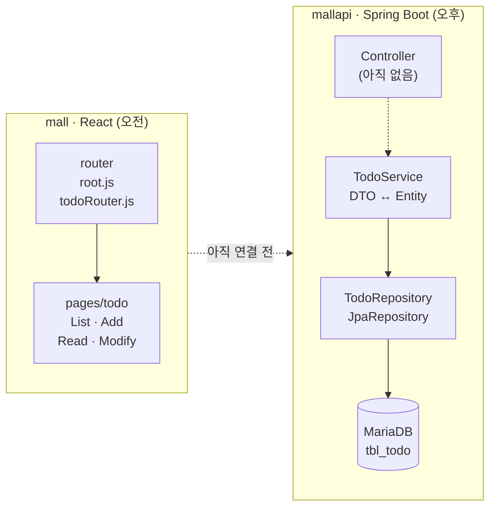

# 2026-10-20 · React 라우팅 + Spring Boot JPA·페이징

> - **오전** React 프로젝트 `mall` — 화면 이동(라우팅) 뼈대와 공통 레이아웃
> - **오후** Spring Boot 프로젝트 `mallapi` — Entity → Repository → Service, 페이징
>
> 아직 Controller가 없어서 프론트와 백엔드는 연결 전이다.

## 핵심 요약

1. `createBrowserRouter`로 **URL ↔ 컴포넌트**를 매핑하고, `RouterProvider`로 앱에 적용한다.
2. 부모 페이지에 `<Outlet />`을 두면 **하위 경로의 페이지가 그 자리에** 들어간다.
3. 경로 변수(`/read/33`)는 `useParams`, 쿼리스트링(`?page=2`)은 `useSearchParams`로 꺼낸다.
4. **Entity**는 DB 테이블과 1:1, **DTO**는 데이터 전달용. 둘의 변환은 Service에서 ModelMapper로 한다.
5. Entity에는 setter 대신 **바꿔도 되는 값만 `changeXxx()` 메서드**로 열어 둔다.
6. `JpaRepository`를 상속만 하면 CRUD·페이징 메서드가 자동으로 생긴다.
7. JPA의 페이지 번호는 **0부터** 시작한다 → 화면에서 받은 `page`에서 `-1`.

## 전체 구조



---

## 1. React — `mall`

### 1-1. 프로젝트 생성 & Tailwind CSS 설정

```bash
npx create-react-app mall
cd mall
npm install react-router-dom
npm install -D tailwindcss@3
npx tailwindcss init        # tailwind.config.js 생성
```

```js
// tailwind.config.js — Tailwind 클래스를 찾아볼 파일 경로를 지정
module.exports = {
  content: ["./src/**/*.{js,ts,jsx,tsx}"],
  theme: { extend: {} },
  plugins: [],
};
```

```css
/* src/index.css 맨 위 */
@tailwind base;
@tailwind components;
@tailwind utilities;
```

> [!WARNING]
> 버전 없이 `npm install -D tailwindcss`를 하면 v4가 설치되는데, v4는 설정 방식이 달라서 `npx tailwindcss init`부터 실행되지 않는다. CRA 프로젝트에서는 **`tailwindcss@3`** 으로 설치한다.

### 1-2. 폴더 구조 — 역할별로 나누기

```
src/
├── router/      # 경로 설정 (root.js, todoRouter.js)
├── layouts/     # 공통 레이아웃 (BasicLayout.js)
├── components/  # 여러 화면에서 재사용하는 조각 (menu/BasicMenu.js)
└── pages/       # 화면 단위 컴포넌트 (MainPage, AboutPage, todo/*)
```

### 1-3. 라우팅 설정 — `createBrowserRouter` + `RouterProvider`

```jsx
// router/root.js
import { lazy, Suspense } from "react";
import { createBrowserRouter } from "react-router-dom";
import todoRouter from "./todoRouter";

const Loading = <div className="text-3xl">Loading...</div>;
const Main = lazy(() => import("../pages/MainPage"));
const About = lazy(() => import("../pages/AboutPage"));
const Todo = lazy(() => import("../pages/todo/IndexPage"));

const root = createBrowserRouter([
  { path: "/", element: <Suspense fallback={Loading}><Main /></Suspense> },
  { path: "/about", element: <Suspense fallback={Loading}><About /></Suspense> },
  {
    path: "/todo",
    element: <Suspense fallback={Loading}><Todo /></Suspense>,
    children: todoRouter(), // /todo 아래 경로는 파일을 나눠서 관리
  },
]);

export default root;
```

- 경로는 `{ path, element }` 객체 배열로 정의한다.
- 만든 라우터는 `App.js`에서 `<RouterProvider router={root} />`로 적용한다.
- **`lazy` + `Suspense`** — 페이지 컴포넌트를 처음에 한꺼번에 불러오지 않고 **해당 경로에 들어갈 때 불러온다**(코드 분할). 불러오는 동안에는 `fallback`(Loading...)이 보인다.
- `lazy`로 불러오는 컴포넌트는 `export default`로 내보내야 한다.
- 실습 코드에선 `createBrowserRouter`를 `require(...)`로 불러왔는데, 위처럼 `import`로 써도 똑같이 동작한다.

### 1-4. 중첩 라우팅 — `children` + `<Outlet />` + `<Navigate />`

```jsx
// router/todoRouter.js  (import와 lazy 선언은 root.js와 같은 방식)
const todoRouter = () => {
  return [
    { path: "",            element: <Navigate replace to="/todo/list" /> },
    { path: "list",        element: <Suspense fallback={Loading}><ListPage /></Suspense> },
    { path: "add",         element: <Suspense fallback={Loading}><AddPage /></Suspense> },
    { path: "read/:tno",   element: <Suspense fallback={Loading}><ReadPage /></Suspense> },
    { path: "modify/:tno", element: <Suspense fallback={Loading}><ModifyPage /></Suspense> },
  ];
};

export default todoRouter;
```

```jsx
// pages/todo/IndexPage.js (핵심 부분)
<BasicLayout>
  <div className="w-full flex m-2 p-2">
    <div onClick={handleClickList}>LIST</div>
    <div onClick={handleClickAdd}>ADD</div>
  </div>
  <div className="flex flex-wrap w-full">
    <Outlet /> {/* ← 이 자리에 List/Add/Read/Modify 페이지가 들어온다 */}
  </div>
</BasicLayout>
```

| URL | 보이는 화면 |
|---|---|
| `/todo` | `/todo/list`로 자동 이동 |
| `/todo/list?page=1&size=10` | IndexPage + **ListPage** |
| `/todo/add` | IndexPage + **AddPage** |
| `/todo/read/33` | IndexPage + **ReadPage** |
| `/todo/modify/33` | IndexPage + **ModifyPage** |

- `children`의 `path`는 부모(`/todo`) 기준 **상대 경로**다. `list` → `/todo/list`
- 부모 화면(IndexPage)은 그대로 두고 **`<Outlet />` 자리만 바뀐다** → LIST·ADD 메뉴를 페이지마다 다시 만들 필요가 없다.
- `<Navigate replace to="...">` — 들어오자마자 다른 경로로 보낸다. `replace`는 방문 기록을 덮어써서, 뒤로 가기를 눌러도 `/todo`로 돌아와 다시 튕겨 나가는 일이 없다.

### 1-5. URL에서 값 꺼내기 — `useParams` vs `useSearchParams`

| | 경로 변수 | 쿼리스트링 |
|---|---|---|
| URL 예시 | `/todo/read/33` | `/todo/list?page=3&size=10` |
| 라우트 설정 | `path: "read/:tno"` | 따로 설정 안 함 |
| 꺼내는 Hook | `useParams()` | `useSearchParams()` |
| 코드 | `const { tno } = useParams();` | `queryParams.get("page")` |
| 주로 쓰는 곳 | 데이터 하나를 가리킬 때 (글 번호) | 목록 조건 (페이지, 검색어) |

```jsx
// pages/todo/ListPage.js
const [queryParams] = useSearchParams();
const page = queryParams.get("page") ? parseInt(queryParams.get("page")) : 1;
const size = queryParams.get("size") ? parseInt(queryParams.get("size")) : 10;
```

- 쿼리스트링 값은 **항상 문자열**이고 없으면 `null`이다 → `parseInt`로 바꾸고, 없을 때는 기본값을 넣는다.

### 1-6. 페이지 이동 — `<Link>` vs `useNavigate()`

| | `<Link to="...">` | `useNavigate()` |
|---|---|---|
| 언제 쓰나 | 메뉴처럼 누르면 바로 이동 | 클릭 이벤트 등 **코드 안에서** 이동 |
| 예시 | `BasicMenu.js` | `IndexPage.js`, `ReadPage.js` |

- `<a href>`를 쓰면 페이지 전체가 새로고침된다. `<Link>`는 새로고침 없이 화면만 바꾼다.

**목록으로 돌아갈 때 보던 페이지 유지하기** — `ReadPage.js`

```jsx
const { tno } = useParams();
const navigate = useNavigate();
const [queryParams] = useSearchParams();
const page = queryParams.get("page") ? parseInt(queryParams.get("page")) : 1;
const size = queryParams.get("size") ? parseInt(queryParams.get("size")) : 10;

const queryStr = createSearchParams({ page, size }).toString(); // "page=3&size=10"

const moveToModify = useCallback(() => {
  navigate({ pathname: `/todo/modify/${tno}`, search: queryStr });
}, [page, tno, size]);

const moveToList = useCallback(() => {
  navigate({ pathname: "/todo/list", search: queryStr });
}, [page, size]);
```

- 3페이지에서 글을 열었다가 목록으로 돌아갈 때 1페이지로 튕기지 않도록, **`page`·`size`를 쿼리스트링에 계속 담아서 이동한다.**
- `createSearchParams({ page, size })` — 객체를 `page=3&size=10` 형태의 문자열로 바꿔 준다.
- `useCallback(함수, [의존값])` — 의존값이 바뀔 때만 함수를 새로 만든다.

### 1-7. 공통 레이아웃 — `children` props

```jsx
// layouts/BasicLayout.js (색·여백 클래스는 생략)
const BasicLayout = ({ children }) => {
  return (
    <>
      <BasicMenu />
      <div className="w-full flex flex-col md:flex-row">
        <main className="md:w-2/3 lg:w-3/4">{children}</main>
        <aside className="md:w-1/3 lg:w-1/4">Sidebar</aside>
      </div>
    </>
  );
};
```

```jsx
// pages/MainPage.js
<BasicLayout>
  <div className="text-3xl">Main Page</div> {/* ← 이 부분이 children으로 전달된다 */}
</BasicLayout>
```

- 컴포넌트 태그 **사이에 넣은 내용**이 `children`으로 전달된다. 메뉴·사이드바는 레이아웃이 그리고, 각 페이지는 본문만 신경 쓰면 된다.
- Tailwind 반응형은 **작은 화면이 기준**이다. 접두사 없는 클래스는 모든 화면에, `md:`는 768px 이상, `lg:`는 1024px 이상에서 적용된다. → 작은 화면은 세로(`flex-col`), 넓은 화면은 가로(`md:flex-row`) 배치.

---

## 2. Spring Boot — `mallapi`

### 2-1. 프로젝트 설정 (STS)

**Spring Boot 4.1.1 · Java 21 · Gradle · War**

| 의존성 | 역할 |
|---|---|
| Spring Web MVC | 웹 / REST API |
| Spring Data JPA | JPA로 DB 다루기 |
| MariaDB Driver | MariaDB 연결 |
| Lombok | getter·생성자·빌더 자동 생성 |
| Spring Boot DevTools | 코드 수정 시 서버 자동 재시작 |
| ModelMapper | DTO ↔ Entity 변환 — 프로젝트 생성 화면엔 없어서 `build.gradle`에 직접 추가 |

```gradle
implementation 'org.modelmapper:modelmapper:3.1.1'
```

- Packaging을 War로 만들면 `ServletInitializer`가 생긴다. 외부 톰캣에 배포할 때 쓰는 클래스라 STS에서 실행할 땐 신경 쓰지 않아도 된다.
- Spring Boot 4부터 `spring-boot-starter-web`이 **`spring-boot-starter-webmvc`** 로 이름이 바뀌었다. 인터넷 자료는 대부분 예전 이름이다.
- Boot 3부터 `javax.persistence` → **`jakarta.persistence`** 다. 옛날 자료의 `javax` import는 쓰면 안 된다.

### 2-2. `application.properties`

```properties
# DB 연결
spring.datasource.driver-class-name=org.mariadb.jdbc.Driver
spring.datasource.url=jdbc:mariadb://localhost:3306/bootex
spring.datasource.username=bootex
spring.datasource.password=bootex

# 엔티티를 보고 테이블을 자동으로 만들거나 수정
spring.jpa.hibernate.ddl-auto=update
# 실행되는 SQL을 콘솔에 출력
spring.jpa.show-sql=true
# 출력되는 SQL을 줄바꿈해서 보기 좋게
spring.jpa.properties.hibernate.format_sql=true

# 파일 업로드 (나중에 사용) — 파일 1개 최대 10MB, 요청 1번 최대 30MB
spring.servlet.multipart.enabled=true
spring.servlet.multipart.location=C:\\upload
spring.servlet.multipart.max-file-size=10MB
spring.servlet.multipart.max-request-size=30MB
# 직접 정의한 설정값 (업로드 경로)
com.fullstack.upload.path=C:\\upload
```

| `ddl-auto` | 동작 |
|---|---|
| `create` | 실행할 때마다 테이블을 지우고 새로 만든다 (데이터 사라짐) |
| `create-drop` | `create` + 서버 종료 시 테이블 삭제 |
| `update` | 엔티티와 비교해서 **없는 테이블·컬럼만 추가** (기존 데이터 유지, 컬럼 삭제는 안 함) |
| `validate` | 엔티티와 테이블이 맞는지 검사만 |
| `none` | 아무것도 안 함 (실제 운영 서버) |

- `.properties`는 **줄 끝 주석이 안 된다**(`#`는 줄 맨 앞에서만 주석). 값 뒤에 주석을 붙이면 주석까지 값으로 들어가서 에러가 난다.

> [!TIP]
> 실습 코드엔 `spring.datasource.dbcp2.driver-class-name`으로 되어 있다. 이건 DBCP2 커넥션 풀 전용 설정이라 스프링 부트 기본 풀(HikariCP)에선 무시된다. 그래도 동작하는 건 URL(`jdbc:mariadb://`)을 보고 드라이버를 자동으로 찾기 때문. 정확한 키는 `spring.datasource.driver-class-name`.

### 2-3. 계층 구조 — 오늘 만든 것

| 패키지 | 클래스 | 하는 일 |
|---|---|---|
| `entity` | `Todo` | DB 테이블(`tbl_todo`)과 1:1로 매핑되는 객체 |
| `repository` | `TodoRepository` | DB 작업 (저장·조회·수정·삭제) |
| `dto` | `TodoDTO`, `PageRequestDTO`, `PageResponseDTO` | 계층 사이·화면으로 데이터를 실어 나르는 객체 |
| `service` | `TodoService`, `TodoServiceImpl` | 비즈니스 로직 + DTO ↔ Entity 변환 |
| `config` | `RootConfig` | ModelMapper를 스프링 빈으로 등록 |

**왜 Entity와 DTO를 나눌까?**

- Entity는 DB와 직결된 객체다. 이걸 화면(JSON)에 그대로 내보내면 테이블 구조가 그대로 드러나고, 화면 요구사항이 바뀔 때마다 Entity(=테이블)를 건드리게 된다.
- 그래서 **바깥(Controller·화면)과는 DTO로 주고받고, DB 작업할 때만 Entity로 바꾼다.** 이 변환을 Service에서 한다.

### 2-4. Entity — `Todo`

```java
@Entity
@Table(name = "tbl_todo")
@Getter
@ToString
@Builder
@AllArgsConstructor
@NoArgsConstructor
public class Todo {
    @Id
    @GeneratedValue(strategy = GenerationType.IDENTITY)
    private Long tno;
    private String title;
    private String writer;
    private boolean complete;
    private LocalDate dueDate; // 완료 목표일

    // setter 대신, 바꿔도 되는 값만 메서드로 열어 둔다
    public void changeTitle(String title) { this.title = title; }
    public void changeComplete(boolean complete) { this.complete = complete; }
    public void changeDueDate(LocalDate dueDate) { this.dueDate = dueDate; }
}
```

| 어노테이션 | 의미 |
|---|---|
| `@Entity` | JPA가 관리하는 엔티티 (테이블과 매핑) |
| `@Table(name = "tbl_todo")` | 매핑할 테이블 이름 (생략하면 클래스 이름) |
| `@Id` | 기본키(PK) |
| `@GeneratedValue(strategy = GenerationType.IDENTITY)` | PK를 DB가 자동 증가(auto_increment)로 만든다 |
| `@NoArgsConstructor` | JPA는 기본 생성자가 반드시 필요 |
| `@Builder` + `@AllArgsConstructor` | `Todo.builder().title("...").build()` 형태로 객체 생성 |
| `@Getter` | getter만 만든다 (setter는 없음) |

- **`@Setter`를 붙이지 않은 이유** — Entity 값이 바뀌면 그게 DB에 반영될 수 있다. 아무 데서나 값을 못 바꾸게 막고, 바꿔도 되는 필드(title, complete, dueDate)만 `changeXxx()`로 연다. `tno`·`writer`는 수정 불가.

### 2-5. Repository — `JpaRepository`

```java
public interface TodoRepository extends JpaRepository<Todo, Long> {
    //                                            <엔티티, PK 타입>
}
```

인터페이스만 만들면 **구현 클래스 없이** 아래 메서드를 바로 쓸 수 있다.

| 메서드 | 하는 일 | 반환 |
|---|---|---|
| `save(entity)` | 저장 (PK가 이미 있으면 수정) | 저장된 엔티티 |
| `findById(id)` | PK로 하나 조회 | `Optional<Todo>` |
| `findAll(pageable)` | 페이징 조회 | `Page<Todo>` |
| `deleteById(id)` | PK로 삭제 | 없음 |

**테스트로 더미 데이터 100개 넣기**

```java
@SpringBootTest
public class RepositoryTest {
    @Autowired
    private TodoRepository todoRepository;

    @Test
    public void testInsert() {
        IntStream.rangeClosed(1, 100).forEach(i -> {
            Todo todo = Todo.builder()
                    .title("Title..." + i)
                    .writer("user" + (i % 10))
                    .complete(i % 2 == 0)
                    .dueDate(LocalDate.of(2026, 12, 25))
                    .build();
            todoRepository.save(todo);
        });
    }
}
```

- `@SpringBootTest` — 스프링을 실제로 띄워서 테스트한다. `@Autowired`로 빈을 주입받아 DB까지 실제로 동작하는지 확인할 수 있다.
- `ddl-auto=update`라서 처음 실행할 때 `tbl_todo` 테이블이 자동으로 만들어진다.

### 2-6. DTO와 ModelMapper

```java
@Data
@Builder
@AllArgsConstructor
@NoArgsConstructor
public class TodoDTO {
    private Long tno;
    private String title;
    private String writer;
    private boolean complete;

    // JSON으로 보낼 때 "2026-12-25" 형식의 문자열로
    @JsonFormat(shape = JsonFormat.Shape.STRING, pattern = "yyyy-MM-dd")
    private LocalDate dueDate;
}
```

- DTO는 DB와 상관없는 전달용이라 `@Data`(getter·setter 등)를 써도 된다.

```java
// config/RootConfig.java
@Configuration
public class RootConfig {
    @Bean
    public ModelMapper getMapper() {
        ModelMapper modelMapper = new ModelMapper();
        modelMapper.getConfiguration()
                // 필드끼리 직접 매칭 + private 필드에도 접근 허용
                .setFieldMatchingEnabled(true)
                .setFieldAccessLevel(org.modelmapper.config.Configuration.AccessLevel.PRIVATE)
                // 이름이 대략 맞으면 매칭 (느슨한 규칙)
                .setMatchingStrategy(MatchingStrategies.LOOSE);
        return modelMapper;
    }
}
```

- `@Configuration` 클래스의 `@Bean` 메서드가 반환한 객체는 **스프링 빈으로 등록**된다 → 다른 클래스에서 주입받아 쓸 수 있다(Service의 `private final ModelMapper modelMapper`).
- `org.modelmapper.config.Configuration`을 풀네임으로 쓴 이유: 스프링의 `@Configuration`과 이름이 겹쳐서 둘 다 import할 수 없다.

> [!IMPORTANT]
> **private 필드 접근을 켜는 이유** — ModelMapper는 기본적으로 setter로 값을 넣는다. 그런데 `Todo`(Entity)엔 setter가 없으니, 이 설정이 없으면 DTO → Entity 변환 때 값이 하나도 안 들어간다. 그래서 필드에 직접 넣도록 설정한다.

### 2-7. Service — CRUD

```java
public interface TodoService {
    Long register(TodoDTO todoDTO);
    TodoDTO get(Long tno);
    void modify(TodoDTO todoDTO);
    void remove(Long tno);
    PageResponseDTO<TodoDTO> list(PageRequestDTO pageRequestDTO);
}
```

```java
@Service
@Transactional
@RequiredArgsConstructor // final 필드를 받는 생성자를 자동 생성 → 생성자 주입
public class TodoServiceImpl implements TodoService {
    private final ModelMapper modelMapper;
    private final TodoRepository todoRepository;

    @Override
    public Long register(TodoDTO todoDTO) {
        Todo todo = modelMapper.map(todoDTO, Todo.class); // DTO → Entity
        Todo savedTodo = todoRepository.save(todo);
        return savedTodo.getTno();                        // DB가 만든 번호
    }

    @Override
    public TodoDTO get(Long tno) {
        Optional<Todo> result = todoRepository.findById(tno);
        Todo todo = result.orElseThrow();                 // 없으면 예외
        return modelMapper.map(todo, TodoDTO.class);      // Entity → DTO
    }

    @Override
    public void modify(TodoDTO todoDTO) {
        Optional<Todo> result = todoRepository.findById(todoDTO.getTno());
        Todo todo = result.orElseThrow();      // ① 먼저 조회하고
        todo.changeTitle(todoDTO.getTitle());  // ② 변경 메서드로 값을 바꾸고
        todo.changeComplete(todoDTO.isComplete());
        todo.changeDueDate(todoDTO.getDueDate());
        todoRepository.save(todo);             // ③ 저장 → UPDATE
    }

    @Override
    public void remove(Long tno) {
        todoRepository.deleteById(tno);
    }

    // list()는 아래 '페이징'에서
}
```

- **생성자 주입** — `final` 필드 + `@RequiredArgsConstructor`면 스프링이 생성자로 빈을 넣어 준다. 필드마다 `@Autowired`를 붙일 필요가 없다.
- **`@Transactional`** — 메서드 하나를 하나의 트랜잭션으로 묶는다. 중간에 런타임 예외가 나면 전부 롤백된다.
- **`Optional`** — 조회 결과가 없을 수도 있다는 걸 표현하는 상자. `orElseThrow()`는 값이 없으면 `NoSuchElementException`을 던진다.
- **수정 = 조회 → 변경 → 저장.** 참고로 `@Transactional` 안에서 조회한 엔티티는 JPA가 계속 지켜보고 있어서, 값만 바꿔도 트랜잭션이 끝날 때 자동으로 UPDATE가 나간다(**변경 감지, dirty checking**). 그래서 여기선 `save()`를 빼도 동작한다.
- `@Transactional`은 import가 두 가지(`jakarta.transaction` / `org.springframework.transaction.annotation`)인데 스프링에선 둘 다 동작한다. 보통은 `readOnly` 같은 옵션을 쓸 수 있는 **스프링 쪽**을 많이 쓴다.

### 2-8. 페이징 — `PageRequestDTO` → `Pageable` → `PageResponseDTO`

```
화면 요청: page=2, size=10
   ↓ PageRequestDTO(page=2, size=10)
   ↓ PageRequest.of(1, 10, tno 내림차순)      ← JPA는 0페이지부터!
   ↓ todoRepository.findAll(pageable)  →  Page<Todo>
   ↓ Entity → DTO 변환 + 페이지 번호 계산
응답: PageResponseDTO<TodoDTO>
```

**① 요청 정보 — `PageRequestDTO`**

```java
@Data
@SuperBuilder
@AllArgsConstructor
@NoArgsConstructor
public class PageRequestDTO {
    @Builder.Default
    private int page = 1;
    @Builder.Default
    private int size = 10;
}
```

- `@Builder.Default` — 빌더로 만들 때 값을 안 넣으면 이 기본값(1, 10)을 쓴다. **안 붙이면 빌더는 `= 1` 초기값을 무시하고 0으로 만든다.**
- `@SuperBuilder` — 이 클래스를 상속한 DTO에서도 부모 필드(page, size)까지 빌더로 채울 수 있게 해 준다.

**② 조회 — `TodoServiceImpl.list()`**

```java
@Override
public PageResponseDTO<TodoDTO> list(PageRequestDTO pageRequestDTO) {
    Pageable pageable = PageRequest.of(
            pageRequestDTO.getPage() - 1,  // ★ JPA 페이지 번호는 0부터
            pageRequestDTO.getSize(),
            Sort.by("tno").descending());  // 최신 글이 먼저

    Page<Todo> result = todoRepository.findAll(pageable);

    List<TodoDTO> dtoList = result.getContent().stream()  // 현재 페이지의 데이터
            .map(todo -> modelMapper.map(todo, TodoDTO.class))
            .collect(Collectors.toList());

    long totalCount = result.getTotalElements();           // 전체 데이터 개수

    return PageResponseDTO.<TodoDTO>withAll()
            .dtoList(dtoList)
            .pageRequestDTO(pageRequestDTO)
            .totalCount(totalCount)
            .build();
}
```

> [!IMPORTANT]
> 화면은 1페이지부터 세지만 JPA의 `PageRequest`는 **0페이지부터** 센다. 그래서 `getPage() - 1`.
>
> 예) 더미 데이터 100개, `page=2, size=10` → `PageRequest.of(1, 10)` → tno **90 ~ 81** 조회

- `Page<Todo>` — `getContent()`는 현재 페이지 목록, `getTotalElements()`는 전체 개수. 전체 개수를 구하려고 **count 쿼리가 한 번 더** 실행된다(콘솔 SQL 로그에서 확인).

**③ 응답 + 페이지 번호 계산 — `PageResponseDTO`**

목록 아래에 `< 1 2 3 … 10 >`처럼 페이지 번호를 **10개씩 묶어서** 보여 주기 위한 계산을 생성자에서 한다.

```java
@Data
public class PageResponseDTO<E> {
    private List<E> dtoList;            // 현재 페이지 데이터
    private List<Integer> pageNumList;  // 화면에 보여 줄 페이지 번호들
    private PageRequestDTO pageRequestDTO;
    private boolean next, prev;         // 다음/이전 버튼 표시 여부
    private int totalCount, prevPage, nextPage, totalPage, current;

    @Builder(builderMethodName = "withAll")
    public PageResponseDTO(List<E> dtoList, PageRequestDTO pageRequestDTO, long totalCount) {
        this.dtoList = dtoList;
        this.pageRequestDTO = pageRequestDTO;
        this.totalCount = (int) totalCount;

        // 페이지 번호 묶음(10개)의 끝 번호와 시작 번호
        int end = (int) (Math.ceil(pageRequestDTO.getPage() / 10.0)) * 10;
        int start = end - 9;
        // last: 전체 개수로 계산한 실제 마지막 페이지
        int last = (int) (Math.ceil(totalCount / (double) pageRequestDTO.getSize()));
        end = end > last ? last : end; // 끝 번호가 last를 넘지 않게

        this.prev = start > 1;
        this.next = totalCount > end * pageRequestDTO.getSize();

        this.pageNumList = IntStream.rangeClosed(start, end).boxed().collect(Collectors.toList());
        if (prev) this.prevPage = start - 1;
        if (next) this.nextPage = end + 1;

        this.totalPage = this.pageNumList.size();
        this.current = pageRequestDTO.getPage();
    }
}
```

**계산 예시** — 전체 123개, `size=10` (실제 마지막 페이지 `last` = 13)

| 요청 page | start | end | prev | next | pageNumList |
|:-:|:-:|:-:|:-:|:-:|:-:|
| 3 | 1 | 10 | ✗ | ✓ (nextPage 11) | 1 ~ 10 |
| 12 | 11 | 13 | ✓ (prevPage 10) | ✗ | 11, 12, 13 |

- `@Builder`를 **생성자에** 붙이면 그 생성자의 파라미터 3개만 빌더로 받는다. `builderMethodName = "withAll"`은 `builder()` 대신 `withAll()`로 시작하게 이름을 바꾼 것.
- 제네릭 클래스(`<E>`)라서 호출할 때 `PageResponseDTO.<TodoDTO>withAll()`처럼 타입을 지정한다. 덕분에 Todo가 아닌 다른 목록에도 그대로 재사용할 수 있다.
- `IntStream.rangeClosed(start, end).boxed()` — `List`에는 기본형 `int`를 못 담기 때문에 `Integer`로 바꾼다(boxing).
- 주의: `totalPage`는 이름과 달리 **현재 묶음의 페이지 번호 개수**(`pageNumList.size()`, 최대 10)다. 위 예시에서 page=3이면 13이 아니라 10. 전체 페이지 수는 계산 중의 `last`.
