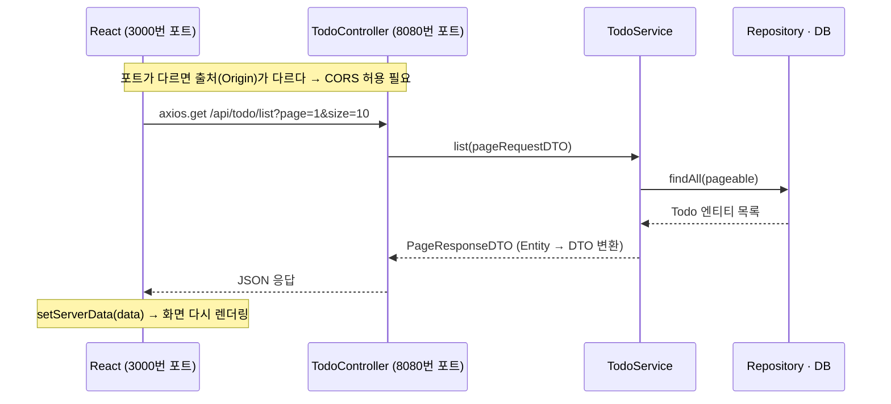
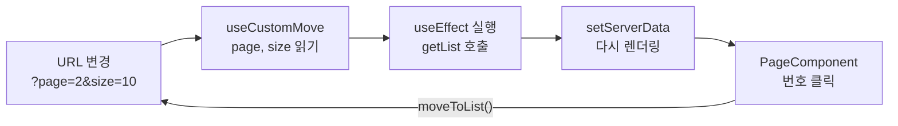

# 📅 2026-10-21 (수) | Todo REST API 완성 & React에서 API 호출하기

> **오늘 한 줄 요약**
> 어제 만든 Service 위에 **Controller를 올려 REST API를 완성**하고, React에서 **axios로 API를 호출**해 목록·조회 화면에 실제 DB 데이터를 띄웠다.

<br>

## 🗺️ 오늘의 큰 흐름

| 순서 | 어디서 | 한 일 | 핵심 키워드 |
|:-:|:-:|---|---|
| 1 | 백엔드 | Controller로 CRUD API 5개 완성 | `@RestController` `@PathVariable` `@RequestBody` |
| 2 | 백엔드 | 예외를 한 곳에서 처리 | `@RestControllerAdvice` `ResponseEntity` |
| 3 | 백엔드 | 날짜 변환기 등록 + CORS 허용 | `Formatter` `WebMvcConfigurer` |
| 4 | 프론트 | API 호출 함수 모듈화 | `axios` `async/await` |
| 5 | 프론트 | 서버 데이터를 화면에 출력 | `useState` `useEffect` |
| 6 | 프론트 | 페이지 이동 로직 재사용 | 커스텀 훅 `useCustomMove` |
| 7 | 프론트 | 페이지 번호 UI | `PageComponent` |

**요청 한 번이 오가는 전체 흐름** (목록 화면 기준)



### 💡 JSP 때와 무엇이 달라졌나?

| | 이전 (JSP) | 지금 (REST API + React) |
|---|---|---|
| 서버가 보내는 것 | 완성된 **HTML 화면** | **데이터(JSON)** 만 |
| 화면을 그리는 곳 | 서버 (JSP) | 브라우저 (React) |
| 컨트롤러 | `@Controller` → 뷰 이름 리턴 | `@RestController` → 객체 리턴 → JSON 자동 변환 |

→ 서버와 화면이 분리됐기 때문에, **둘을 연결하는 작업(API 설계 · CORS · axios)** 이 오늘의 핵심이다.

<br>

## 📁 오늘 추가한 파일

```
mallapi (Spring Boot)
└─ src/main/java/com/fullstack
   ├─ controller
   │  ├─ TodoController.java                 ← REST API (CRUD)
   │  ├─ advice/CustomControllerAdvice.java  ← 전역 예외 처리
   │  └─ formatter/LocalDateFormatter.java   ← 문자열 ↔ LocalDate
   └─ config/CustomServletConfig.java        ← Formatter 등록 + CORS 설정

mall (React)
└─ src
   ├─ api/todoApi.js                         ← axios 호출 함수 모음
   ├─ hooks/useCustomMove.js                 ← 페이지 이동 커스텀 훅
   ├─ components
   │  ├─ common/PageComponent.js             ← 페이지 번호 UI (재사용)
   │  └─ todo/ReadComponent.js, ListComponent.js
   └─ pages/todo/ReadPage.js, ListPage.js
```

---

## Part 1. 백엔드 — REST API 완성 (mallapi)

### 1-1. TodoController : URL + HTTP 메서드로 기능을 구분한다

| 기능 | 메서드 | URL | 받는 데이터 | 응답 예시 |
|---|---|---|---|---|
| 조회 | `GET` | `/api/todo/{tno}` | 경로 변수 | `TodoDTO` |
| 목록 | `GET` | `/api/todo/list?page=1&size=10` | 쿼리스트링 | `PageResponseDTO` |
| 등록 | `POST` | `/api/todo/` | JSON 본문 | `{"TNO": 101}` |
| 수정 | `PUT` | `/api/todo/{tno}` | 경로 변수 + JSON 본문 | `{"RESULT": "SUCCESS"}` |
| 삭제 | `DELETE` | `/api/todo/{tno}` | 경로 변수 | `{"RESULT": "SUCCESS"}` |

> 같은 `/api/todo/33` 이라도 **GET이면 조회, PUT이면 수정, DELETE면 삭제** → 이게 REST 방식

```java
@RestController                  // = @Controller + @ResponseBody → 리턴한 객체가 JSON으로 응답됨
@RequiredArgsConstructor
@RequestMapping("/api/todo")
public class TodoController {
    private final TodoService todoService;

    @GetMapping("/{tno}")        // 조회
    public TodoDTO get(@PathVariable(name = "tno") Long tno) {   // name 명시 (아래 '주의할 점' 참고)
        return todoService.get(tno);
    }

    @GetMapping("/list")         // 목록: ?page=2&size=10 → PageRequestDTO에 자동으로 담김
    public PageResponseDTO<TodoDTO> list(PageRequestDTO pageRequestDTO) {
        return todoService.list(pageRequestDTO);
    }

    @PostMapping("/")            // 등록: 요청 본문의 JSON → TodoDTO
    public Map<String, Long> register(@RequestBody TodoDTO todoDTO) {
        Long tno = todoService.register(todoDTO);
        return Map.of("TNO", tno);   // 간단한 결과는 Map으로 → {"TNO": 101}
    }

    // 수정 @PutMapping("/{tno}"), 삭제 @DeleteMapping("/{tno}") 도 같은 패턴
}
```

**📌 파라미터를 받는 3가지 방법** (오늘 제일 중요!)

| 어노테이션 | 값이 들어있는 곳 | 예시 | 사용한 곳 |
|---|---|---|---|
| `@PathVariable` | URL 경로 | `/api/todo/33` | 조회·수정·삭제의 `tno` |
| 없음 (DTO로 받기) | 쿼리스트링 | `?page=2&size=10` | 목록의 `PageRequestDTO` |
| `@RequestBody` | 요청 본문 (JSON) | `{"title": "공부"}` | 등록·수정의 `TodoDTO` |

> [!TIP]
> 브라우저 주소창으로는 GET만 테스트할 수 있다. POST·PUT·DELETE는 Postman 같은 API 테스트 도구로 확인한다.

### 1-2. 예외 처리 : `@RestControllerAdvice` 로 한 곳에서

없는 번호를 조회하면 이렇게 흘러간다.

```
GET /api/todo/999
 → Service : findById(999).orElseThrow()   → NoSuchElementException 발생
 → CustomControllerAdvice 가 가로챔
 → 404 + {"msg": "No value present"}        (처리 안 하면 500 에러로 응답됨)
```

```java
@RestControllerAdvice   // 모든 @RestController에서 터진 예외를 여기서 처리
public class CustomControllerAdvice {

    @ExceptionHandler(NoSuchElementException.class)    // 어떤 예외를 잡을지 지정
    protected ResponseEntity<?> notExist(NoSuchElementException e) {
        return ResponseEntity.status(HttpStatus.NOT_FOUND)       // 상태 코드 404
                             .body(Map.of("msg", e.getMessage()));
    }

    // MethodArgumentNotValidException → 406 (나중에 @Valid 검증이 실패할 때 동작)
}
```

- `ResponseEntity` : **상태 코드 + 응답 본문**을 직접 정해서 보낼 때 사용
- 컨트롤러마다 try-catch를 쓰지 않고, 예외 처리를 한 군데로 모을 수 있다

### 1-3. 날짜 변환 : Formatter

```java
public class LocalDateFormatter implements Formatter<LocalDate> {
    @Override   // 문자열 "2026-12-25" → LocalDate
    public LocalDate parse(String text, Locale locale) {
        return LocalDate.parse(text, DateTimeFormatter.ofPattern("yyyy-MM-dd"));
    }

    @Override   // LocalDate → 문자열 "2026-12-25"
    public String print(LocalDate object, Locale locale) {
        return DateTimeFormatter.ofPattern("yyyy-MM-dd").format(object);
    }
}
```

- 만들기만 하면 안 되고, 아래 `CustomServletConfig` 의 **`addFormatters()` 에 등록해야 동작**한다

> [!NOTE]
> 날짜가 **어디로 들어오느냐**에 따라 변환 담당이 다르다.
> - 쿼리스트링·폼 파라미터 (`?dueDate=2026-12-25`) → **Formatter** (`LocalDateFormatter`)
> - JSON 본문·JSON 응답 (`{"dueDate": "2026-12-25"}`) → **Jackson** (`TodoDTO` 의 `@JsonFormat`)

### 1-4. CORS 설정 : React가 API를 호출할 수 있게

**왜 필요할까?** React(`localhost:3000`)와 API 서버(`localhost:8080`)는 **포트가 달라서 서로 다른 출처(Origin)** 다.
브라우저는 보안상 다른 출처의 응답을 막는다 → **서버**가 "이 출처는 허용한다"고 알려줘야 한다.

```java
@Configuration
public class CustomServletConfig implements WebMvcConfigurer {   // 스프링 MVC 설정을 커스터마이징

    @Override   // ① 날짜 Formatter 등록
    public void addFormatters(FormatterRegistry registry) {
        registry.addFormatter(new LocalDateFormatter());
    }

    @Override   // ② CORS 허용
    public void addCorsMappings(CorsRegistry registry) {
        registry.addMapping("/**")                    // 모든 경로에 대해
                .allowedOriginPatterns("*")           // 모든 출처 허용
                .allowedMethods("GET", "POST", "PUT", "HEAD", "DELETE", "OPTIONS")
                .allowedHeaders("Authorization", "Cache-Control", "Content-Type")
                .allowCredentials(true)
                .maxAge(300);                         // 사전 요청(Preflight) 결과를 300초 동안 캐시
    }
}
```

> [!IMPORTANT]
> CORS는 **브라우저**의 보안 정책이다. 그래서 Postman이나 주소창에서는 잘 되는데 **React에서만 에러**가 난다면 → CORS 설정부터 의심하자.

- `OPTIONS` : PUT·DELETE나 JSON을 보내는 요청 전에 브라우저가 "보내도 돼?" 하고 먼저 보내는 **사전 요청(Preflight)** 용
- 실무에서는 `"*"` 대신 실제 프론트엔드 주소만 허용한다

---

## Part 2. 프론트엔드 — API 호출해서 화면에 출력 (mall)

### 2-1. axios : API 호출 코드는 `api/` 폴더에 모은다

```bash
npm install axios
```

```js
// src/api/todoApi.js
import axios from "axios";

export const API_SERVER_HOST = "http://localhost:8080";
const prefix = `${API_SERVER_HOST}/api/todo`;

export const getOne = async (tno) => {
    const res = await axios.get(`${prefix}/${tno}`);   // 응답이 올 때까지 기다림
    return res.data;                                  // 실제 데이터는 res.data 안에 있다
};

export const getList = async (pageParam) => {
    const { page, size } = pageParam;
    const res = await axios.get(`${prefix}/list`, { params: { page, size } });  // → /list?page=1&size=10
    return res.data;
};
```

- 컴포넌트마다 axios 코드를 쓰지 않고 한 파일에 모아두면 → **서버 주소가 바뀌어도 한 곳만 수정**
- `async` 함수는 항상 **Promise**를 리턴한다 → 컴포넌트에서는 `.then(data => ...)` 으로 결과를 받는다

### 2-2. 서버 데이터 출력 : `useState` + `useEffect` (ReadComponent)

```jsx
const initState = { tno: 0, title: "", writer: "", complete: false, dueDate: "" };

const ReadComponent = ({ tno }) => {
    const [todo, setTodo] = useState(initState);      // ① 처음엔 빈 값으로 화면을 그림
    const { moveToList, moveToModify } = useCustomMove();

    useEffect(() => {
        getOne(tno).then(data => setTodo(data));       // ② 서버 호출 → ③ state 변경 → 다시 렌더링
    }, [tno]);                                         // tno가 바뀔 때만 다시 호출

    return (
        <div>
            {makeDiv("제목", todo.title)}
            {makeDiv("마감일", todo.dueDate)}            {/* 키 이름은 대소문자까지 DTO와 똑같이! */}
            <button onClick={() => moveToList()}>List</button>
            <button onClick={() => moveToModify(tno)}>Modify</button>
        </div>
    );
};
```

**렌더링 순서** : 빈 화면(initState) → `useEffect` 실행 → 서버 응답 → `setTodo` → 실제 데이터로 다시 렌더링

| 의존성 배열 | 언제 실행될까? |
|---|---|
| `[]` | 처음 한 번만 |
| `[tno]` | 처음 + `tno` 가 바뀔 때마다 |
| 생략 | 렌더링될 때마다 → `setState` 와 같이 쓰면 **무한 요청** ⚠️ |

- `initState` 를 두는 이유 : 데이터가 오기 전 첫 렌더링에서 `undefined` 에러가 나지 않게 하려고

### 2-3. 커스텀 훅 : `useCustomMove` 로 이동 로직 재사용

**문제** : 조회·목록·수정 화면마다 "쿼리스트링에서 page·size 꺼내기 + navigate로 이동" 코드가 반복된다.
(ReadPage에 주석 처리해 둔 코드가 바로 그 이전 방식)

**해결** : 반복되는 로직을 `use` 로 시작하는 함수 하나로 묶어서, 어떤 컴포넌트에서든 꺼내 쓴다.

```js
// src/hooks/useCustomMove.js
const useCustomMove = () => {
    const navigate = useNavigate();                      // 코드로 페이지 이동
    const [queryParams] = useSearchParams();             // 현재 URL의 쿼리스트링 읽기

    const page = getNum(queryParams.get("page"), 1);     // 값이 없으면 기본값 1
    const size = getNum(queryParams.get("size"), 10);
    const queryDefault = createSearchParams({ page, size }).toString();  // "page=3&size=10"

    const moveToList = (pageParam) => {
        let queryStr = queryDefault;                     // 인자가 없으면 → 보던 페이지 유지
        if (pageParam) {                                 // 인자가 있으면 → 그 페이지로
            queryStr = createSearchParams({
                page: getNum(pageParam.page, 1),
                size: getNum(pageParam.size, 10),
            }).toString();
        }
        navigate({ pathname: "../list", search: queryStr });
    };

    const moveToModify = (tno) => {
        navigate({ pathname: `../modify/${tno}`, search: queryDefault });
    };

    return { moveToList, moveToModify, page, size };
};
```

- **핵심 목적** : 목록 3페이지 → 글 조회 → 다시 목록을 눌렀을 때 **보던 3페이지로 돌아오게** (page·size를 계속 들고 다닌다)
- `../list` : 현재 라우트 기준 상대 경로 (`/todo/read/33` → `/todo/list`)
- **훅 규칙** : 이름은 반드시 `use` 로 시작 / 컴포넌트 최상단에서만 호출 (if문·반복문 안에서 호출 ❌)

### 2-4. 페이징 : ListComponent + PageComponent

**핵심 아이디어 : 현재 페이지 번호를 `useState` 가 아니라 URL(쿼리스트링)에 둔다**



→ 새로고침·뒤로가기를 해도, 링크를 공유해도 같은 페이지가 유지된다.

```jsx
// ListComponent.js
const initState = {            // 서버의 PageResponseDTO 모양 그대로 초기화
    dtoList: [], pageNumList: [], pageRequestDTO: null,
    prev: false, next: false, totalCount: 0,
    prevPage: 0, nextPage: 0, totalPage: 0, current: 0
};

const ListComponent = () => {
    const { page, size, moveToList } = useCustomMove();
    const [serverData, setServerData] = useState(initState);

    useEffect(() => {
        getList({ page, size }).then(data => setServerData(data));
    }, [page, size]);          // URL의 page·size가 바뀌면 → 다시 요청

    return (
        <div>
            {serverData.dtoList.map(todo =>
                <div key={todo.tno}>{todo.tno} {todo.title} {todo.dueDate}</div>
            )}
            <PageComponent serverData={serverData} movePage={moveToList} />
        </div>
    );
};
```

```jsx
// PageComponent.js — 데이터와 이동 함수를 props로 받아서 그리기만 한다
const PageComponent = ({ serverData, movePage }) => (
    <div className="flex justify-center">
        {serverData.prev && <div onClick={() => movePage({ page: serverData.prevPage })}>Prev</div>}

        {serverData.pageNumList.map(pageNum =>
            <div key={pageNum}
                 className={serverData.current === pageNum ? "bg-gray-500" : "bg-blue-400"}  // 현재 페이지 강조
                 onClick={() => movePage({ page: pageNum })}>
                {pageNum}
            </div>
        )}

        {serverData.next && <div onClick={() => movePage({ page: serverData.nextPage })}>Next</div>}
    </div>
);
```

- PageComponent는 Todo를 전혀 모른다 → 나중에 **상품 목록 같은 다른 화면에서도 그대로 재사용** (그래서 `components/common`)
- `map` 으로 목록을 그릴 때는 `key` 필수

---

## ⚠️ 헷갈렸던 / 주의할 점

| 증상 | 원인 | 해결 |
|---|---|---|
| `parameter name information not available` 에러 | STS(이클립스)는 기본 설정에서 `-parameters` 옵션 없이 컴파일 → Spring Boot 3.2부터는 파라미터 이름을 알아낼 수 없음 | `@PathVariable(name = "tno")` 처럼 이름을 명시 |
| POST `/api/todo` 가 404 | `@PostMapping("/")` 의 실제 주소는 `/api/todo/` (Spring 6부터 끝의 `/` 를 구분) | 호출할 때 끝의 `/` 까지 정확히 |
| `allowedOrigins("*")` 로 쓰면 서버 에러 | `allowCredentials(true)` 와 `"*"` 는 같이 쓸 수 없음 | `allowedOriginPatterns("*")` 사용 |
| Postman은 되는데 React에서만 에러 | CORS (브라우저의 정책) | 서버에 `addCorsMappings` 설정 |
| 화면에 마감일이 안 나옴 | JSON 키는 DTO 필드명과 대소문자까지 같아야 함 (`dueDate` ≠ `duedate`) | `todo.dueDate` 로 접근 |
| List 버튼을 누르면 항상 1페이지로 감 | `onClick={moveToList}` 로 쓰면 클릭 이벤트 객체가 `pageParam` 으로 들어감 | `onClick={() => moveToList()}` |
| 페이지 번호를 눌러도 목록이 그대로 | `useEffect` 의존성 배열에 `page` 가 없음 | `[page, size]` 로 지정 |
| `console.log` 가 두 번 찍힘 | 개발 모드의 `<React.StrictMode>` 가 effect를 한 번 더 실행 | 정상 (빌드한 배포 버전에선 1번) |

<br>

## ✅ 복습 질문

<details>
<summary>Q1. <code>@Controller</code> 와 <code>@RestController</code> 의 차이는?</summary>

`@Controller` 는 뷰(JSP) 이름을 리턴해서 **화면**을 응답하고, `@RestController` 는 리턴한 객체를 JSON으로 바꿔서 **데이터**를 응답한다. (`@RestController` = `@Controller` + `@ResponseBody`)
</details>

<details>
<summary>Q2. <code>@PathVariable</code>, <code>@RequestBody</code>, 어노테이션 없는 DTO 파라미터는 각각 어디서 값을 꺼낼까?</summary>

URL 경로(`/api/todo/33`) / 요청 본문의 JSON / 쿼리스트링(`?page=2&size=10`)
</details>

<details>
<summary>Q3. CORS 에러는 왜 나고, 어디서 해결할까?</summary>

React(3000)와 서버(8080)의 출처가 달라서 브라우저가 응답을 막는다. 프론트가 아니라 **서버**에서 허용해줘야 한다 → `WebMvcConfigurer` 의 `addCorsMappings()`
</details>

<details>
<summary>Q4. ListComponent의 useEffect 의존성 배열에 <code>[page, size]</code> 를 넣는 이유는?</summary>

페이지 번호를 클릭하면 URL의 page가 바뀌고, 그때마다 목록을 다시 불러와야 하기 때문. 빈 배열(`[]`)이면 처음 한 번만 호출돼서 번호를 눌러도 목록이 바뀌지 않는다.
</details>

<details>
<summary>Q5. 현재 페이지 번호를 useState가 아니라 URL에 두는 이유는?</summary>

새로고침·뒤로가기·링크 공유를 해도 같은 페이지가 유지되고, 조회 화면에 갔다가 목록으로 돌아올 때 보던 페이지로 복귀할 수 있기 때문.
</details>

<br>

> 🔜 **남은 작업** : API는 CRUD 전부 완성됐지만, React에는 아직 조회·목록만 연결됨 → 등록·수정·삭제 화면 연동
